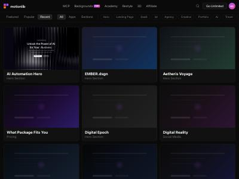

# motionlib-ai

AI로 만든 웹사이트 템플릿과 프롬프트를 모아 보여 주는 갤러리 사이트예요.

🔗 **배포 주소:** https://motionlib-ai.vercel.app/



## 소개
다크 테마 갤러리에서 Hero, Landing Page, SaaS, 3D, Portfolio, Fintech 같은 분류별로 템플릿을 둘러볼 수 있어요. 지금은 초기 단계라서 화면 구성은 거의 끝났고, 상세 페이지는 `/hero` 하나만 만들어져 있어요.

## 주요 화면
| 영역 | 내용 |
|---|---|
| 상단 메뉴 | MCP · Backgrounds · Academy · Restyle · 3D · Affiliate, 검색, Go Unlimited |
| 정렬 탭 | Featured / Popular / Recent |
| 카테고리 칩 | All, Apps, Sections, Hero, Landing Page, SaaS, 3D, Agency, Portfolio, AI, Fintech, Ecommerce, Pricing 등 |
| 템플릿 카드 | 18개 (AI Automation Hero, EMBER.dsgn, Velaris, Nomi AI Agent 등) |
| Backgrounds | 움직이는 배경 카드 6개 |
| Academy | AI 디자인 강의 소개 |

### `/hero` — AI Automation Hero
Mux 스트리밍 영상 배경 위에 제목이 한 글자씩 나타나는 히어로 섹션이에요.


## 기술 스택
- [Next.js 15](https://nextjs.org/) (App Router) + React 19 + TypeScript
- 직접 작성한 CSS (`app/globals.css`, 컴포넌트 안 스타일)
- [framer-motion](https://motion.dev/): 애니메이션
- [hls.js](https://github.com/video-dev/hls.js) + [Mux](https://www.mux.com/): 배경 영상 스트리밍
- [lucide-react](https://lucide.dev/): 아이콘
- [Vercel](https://vercel.com/): 배포 (GitHub `main`에 올리면 자동 배포)

## 실행 방법
```bash
npm install
npm run dev
```
브라우저에서 http://localhost:3000 을 열면 돼요. 배포용 빌드는 `npm run build`로 확인할 수 있어요.

## 폴더 구조
```
app/
  page.tsx          홈 (갤러리)
  hero/page.tsx     AI Automation Hero 페이지
  layout.tsx        공통 레이아웃, 메타 정보
  globals.css       공통 스타일
components/
  motionsites-navbar.tsx         상단 메뉴
  motionsites-filter-bar.tsx     정렬 탭 + 카테고리 칩
  motionsites-template-card.tsx  템플릿 카드
  motionsites-sections.tsx       Backgrounds, Academy 섹션
  motionsites-logo.tsx           로고
  ai-automation-hero.tsx         /hero 히어로 섹션
lib/
  template-data.ts  카드 목록 데이터
```

## 진행 상황
| 기능 | 상태 |
|---|---|
| 카테고리 필터 | ✅ 작동 |
| `/hero` 상세 페이지 | ✅ 완성 |
| 정렬 탭 (Featured / Popular / Recent) | ⚠️ 선택 표시만 바뀌고 순서는 그대로 |
| 나머지 카드 17개 상세 페이지 | ❌ 아직 없음 |
| 상단 메뉴 · 버튼 링크 | ❌ 아직 `#` |
| 로그인 · 결제 · 검색 | ❌ 아직 없음 |

## 할 일
- [ ] 카드마다 상세 페이지 만들기
- [ ] 정렬 탭 기능 연결
- [ ] 모바일 햄버거 메뉴 추가 (375px에서 상단 메뉴가 잘림)
- [ ] `/hero` 영상 로딩 중 포스터 이미지 넣기
- [ ] 사이트 이름 통일 ("MotionSites AI" / "motionlib") + og:image 추가
- [ ] 카드 hover 효과 추가

## 문서
- [분석보고서.md](분석보고서.md): 배포된 사이트를 분석한 전체 내용
- [screenshots/](screenshots/): 분석할 때 찍은 화면 캡처
